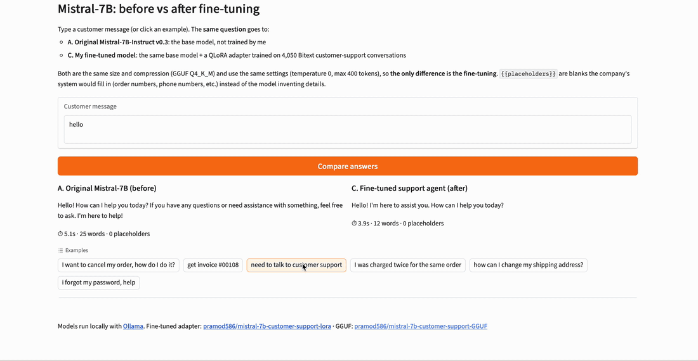
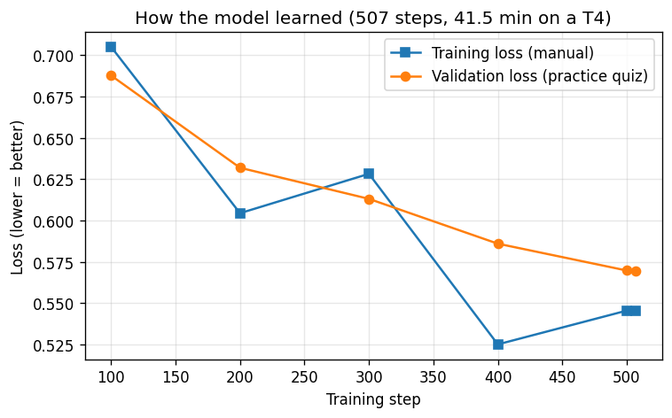
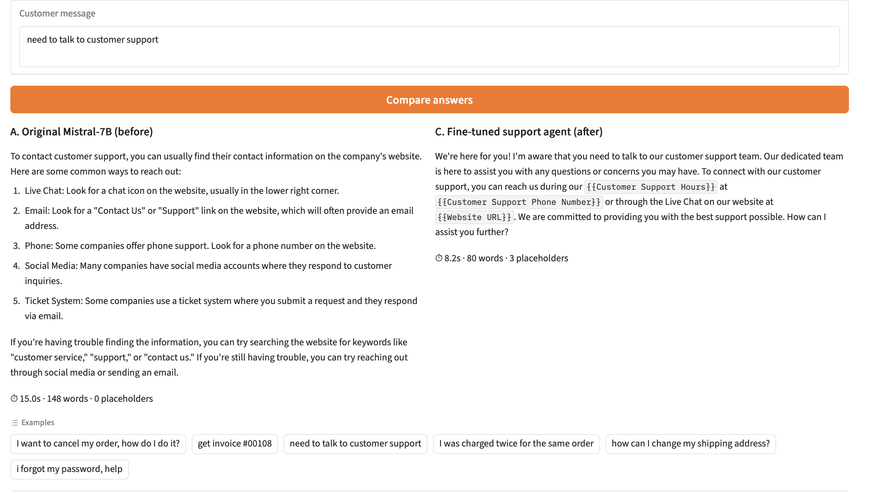
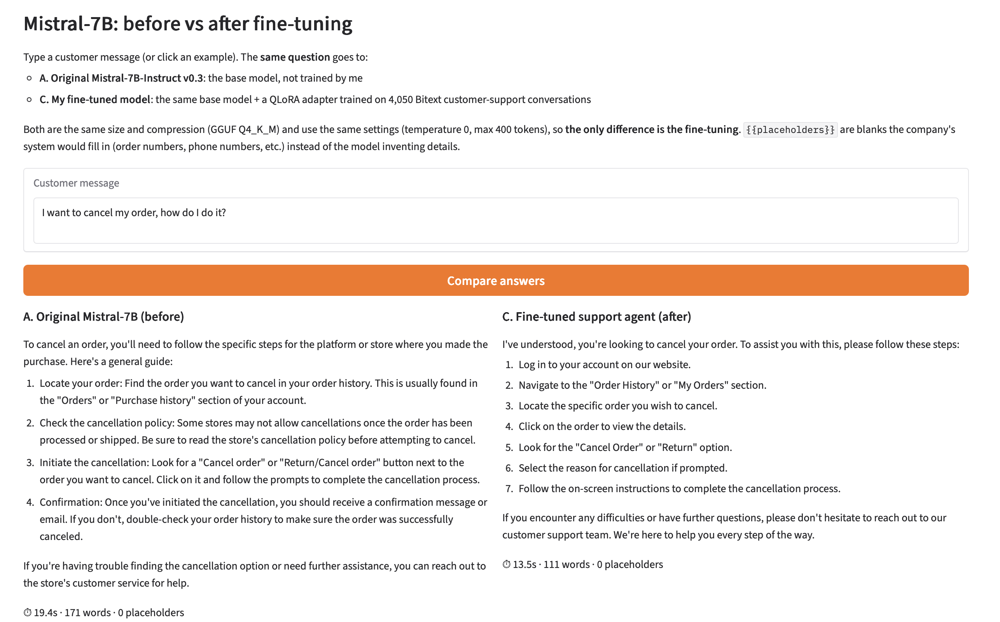

# Fine-tuning Mistral-7B into a customer-support agent (QLoRA on a free Colab T4)

**Pramod Gaikwad** · [GitHub](https://github.com/pramod-nanu) · [Hugging Face](https://huggingface.co/pramod586)

I fine-tuned **Mistral-7B-Instruct v0.3** to reply like a company's customer-support agent. I trained it with **QLoRA** on Google Colab's free T4 GPU, measured it against the original model on 200 held-out questions, published it on Hugging Face, and built a side-by-side demo that runs locally on a MacBook.

[](https://colab.research.google.com/github/pramod-nanu/mistral-7b-customer-support-finetune/blob/main/notebooks/try_the_demo.ipynb)
&nbsp; **Model:** [adapter](https://huggingface.co/pramod586/mistral-7b-customer-support-lora) · [GGUF](https://huggingface.co/pramod586/mistral-7b-customer-support-GGUF)



---

## Results at a glance

Each version answered the same **200 questions that were never used in training**:

| | A. Original Mistral | B. Original + "you are a support agent" prompt | **C. Fine-tuned (mine)** | Target (Bitext reference) |
|---|---|---|---|---|
| Uses `{{placeholders}}` instead of inventing details | 11% | 19% | **48.5%** | 52% |
| Invents contact details (fake emails, URLs, phone numbers) | 3% | 10% | **0%** | 0.5% |
| Signs off like a letter ("[Your Name]") | 4.5% | 70.5% | **0%** | 0% |
| Says "as an AI" / "I don't have access" | 3% | 0% | **0%** | 0.5% |
| Average answer length (words) | 186 | 200 | **100** | 103 |
| ROUGE-L vs reference (wording, 0–1) | 0.186 | 0.222 | **0.454** | |
| Meaning similarity vs reference (0–1) | 0.674 | 0.703 | **0.875** | |

**In plain words:** after fine-tuning, the model speaks as the company's own agent, writes half as many words, leaves blanks such as `{{Order Number}}` instead of making things up, and its answers are much closer to the reference answers in both wording and meaning. Giving the original model a "support agent" prompt (B) made it *sound* like an agent, but it then invented email addresses and wrote formal letters 70% of the time. Prompting alone wasn't enough.

---

## The problem

General chat models are good at explaining things, but a support bot needs to behave like *the company's* agent:

| Original Mistral says | A support agent should say |
|---|---|
| "…the website **where you made the purchase**", "reach out to **the seller**" | "log in to **our** website… **we're** here to help" |
| "I've **checked our records** and found…" (it hasn't) | leave a `{{placeholder}}` for real data |
| `support@online-store.com` (made up; invented contact details appeared in 10% of the prompted model's answers) | `{{Customer Support Phone Number}}` |
| ~190 words, ending with "Best regards, [Your Name]" | ~100 words, ending with an offer to help further |

## Approach

| Step | What I did | Notebook |
|---|---|---|
| 0. Setup | Colab T4 GPU, Hugging Face write token stored in Colab Secrets, Google Drive for persistence | [00](notebooks/00_setup_check.ipynb) |
| 1. Data | [Bitext customer-support dataset](https://huggingface.co/datasets/bitext/Bitext-customer-support-llm-chatbot-training-dataset) (26,872 Q&A pairs, 27 intents). Held out a **200-question test set first** (stratified by intent, duplicate-checked), then sampled **4,050 training** (150 per intent) and **216 validation** examples. Converted to Mistral's chat format and checked token lengths (max 1,024) | [01](notebooks/01_data_prep.ipynb) |
| 2–3. Baseline | Loaded Mistral in 4-bit and recorded the original model's answers to the 200 test questions, both plain (A) and with a support-agent system prompt (B) | [02](notebooks/02_load_and_baseline.ipynb) |
| 4. Training | QLoRA with Unsloth + TRL, trained on the **agent's answers only** (customer turns masked from the loss) | [03](notebooks/03_train_evaluate_publish.ipynb) |
| 5. Evaluation | Same 200 questions for the fine-tuned model (C); behaviour scoreboard, ROUGE-L, embedding similarity (MiniLM), side-by-side examples | [03](notebooks/03_train_evaluate_publish.ipynb) |
| 6. Publish | Pushed the adapter and a model card to Hugging Face | [03](notebooks/03_train_evaluate_publish.ipynb) |
| 7. GGUF | Merged the adapter into the base model, quantised it to **GGUF Q4_K_M (4.4 GB)** so it runs without a GPU, and tested it on a CPU | [03](notebooks/03_train_evaluate_publish.ipynb), [04](notebooks/04_test_gguf_cpu.ipynb) |
| 8. Demo | Gradio app comparing original vs fine-tuned side by side, both served locally by Ollama | [demo/app.py](demo/app.py) |

### Training setup

| Setting | Value |
|---|---|
| Base model | `unsloth/mistral-7b-instruct-v0.3-bnb-4bit` (4-bit NF4) |
| LoRA | r=16, alpha=16, dropout 0, all attention + MLP projections. **41.9M trainable parameters (0.58% of 7.29B)** |
| Optimisation | 1 epoch, 507 steps, effective batch 8 (2 × 4 gradient accumulation), lr 2e-4 linear, 10 warm-up steps, AdamW 8-bit, fp16 |
| Hardware / time | 1× NVIDIA T4 (free Colab), **41.5 minutes**, peak GPU memory 14.2 GB of 15.6 GB |
| Loss | train 0.705 → 0.546 · validation 0.688 → **0.570** (steadily falling and close to train, so the model was not memorising) |



## Before vs after: examples

"need to talk to customer support": 148 words with generic advice (left) vs 80 words in the company's voice with placeholders (right):



<details>
<summary>"I want to cancel my order, how do I do it?"</summary>


</details>

More: [5 test questions answered by A, B, C and the reference](results/final_samples.md).

---

## Run the demo

### Option 1: in your browser (Google Colab, free)
Click **Open in Colab** above → *Runtime → Change runtime type → T4 GPU* → *Run all*. After about 5–10 minutes the last cell prints a temporary `https://….gradio.live` link.

### Option 2: on your own computer (Ollama)
Requires [Ollama](https://ollama.com), Python 3.10+, and about 9 GB of disk space. 8 GB of RAM is enough because the app loads one model at a time.

```bash
# 1. Download both models (about 4.4 GB each) and give them short names
ollama pull hf.co/pramod586/mistral-7b-customer-support-GGUF:Q4_K_M
ollama cp   hf.co/pramod586/mistral-7b-customer-support-GGUF:Q4_K_M support-agent
ollama pull mistral:7b-instruct-v0.3-q4_K_M
ollama cp   mistral:7b-instruct-v0.3-q4_K_M mistral-original

# 2. Install and run the app
python -m venv .venv && source .venv/bin/activate
pip install -r demo/requirements.txt
python demo/app.py          # open http://127.0.0.1:7860
```

To chat with just the fine-tuned model: `ollama run support-agent`.

---

## What I learned

- **Fine-tuning changes behaviour, not knowledge.** The original model already knew how to cancel an order. Fine-tuning taught it the *role* (speak as the company, acknowledge the customer first, keep it short, use placeholders). New facts such as real order data would come from a database or RAG instead.
- **A prompt is a strong baseline, but it isn't enough.** The "support agent" system prompt made the model act the part, and also made it invent contact details and write formal letters. Measuring B separately from A is what showed this.
- **Evaluate on data the model never saw.** I locked away the test set before doing anything else and checked it had zero overlap with the training data.
- **The model learns the data's quirks too.** Bitext's own answers sometimes repeat a placeholder or take odd phrasing literally (e.g. "earn a product"), and the fine-tuned model copies that. The model can only be as good as its training data.
- **Working within a free GPU's limits:** 4-bit loading, LoRA on 0.58% of the weights, gradient checkpointing, checkpoints saved to Drive so a disconnect doesn't lose progress, and batched, resumable evaluation.
- **Deployment:** GGUF quantisation lets a 7B model run on a laptop without a dedicated GPU. Results can differ slightly between runtimes (Unsloth on GPU vs llama.cpp/Ollama), so I tested the final GGUF file directly.

## Limitations

- Answers contain `{{placeholders}}` that a real system would fill in with order numbers, phone numbers and so on.
- English only, and trained on a generic online-store support domain. It has no access to real orders or accounts.
- Evaluation uses automatic metrics on 200 questions, with no human rating.
- Only training/validation loss at 100-step intervals was kept from the training run.

## Repository layout

```
notebooks/   00–04: the full pipeline, with outputs  ·  try_the_demo.ipynb: Colab demo
demo/        app.py (Gradio side-by-side demo), requirements.txt
results/     scoreboard, similarity, sample answers, raw A/B/C answers (.jsonl), training log + chart
assets/      demo GIF and screenshots
```

The data splits are not committed. `01_data_prep.ipynb` recreates them exactly (fixed seed 42).

## Author

**Pramod Gaikwad**: [GitHub](https://github.com/pramod-nanu) · [Hugging Face](https://huggingface.co/pramod586)

## Credits

[Mistral AI](https://huggingface.co/mistralai/Mistral-7B-Instruct-v0.3) (base model, Apache 2.0) ·
[Bitext](https://huggingface.co/datasets/bitext/Bitext-customer-support-llm-chatbot-training-dataset) (dataset) ·
[Unsloth](https://github.com/unslothai/unsloth), Hugging Face [TRL](https://github.com/huggingface/trl) & [PEFT](https://github.com/huggingface/peft) (training) ·
[llama.cpp](https://github.com/ggml-org/llama.cpp) / [Ollama](https://ollama.com) (GGUF inference) · [Gradio](https://gradio.app) (demo UI)
